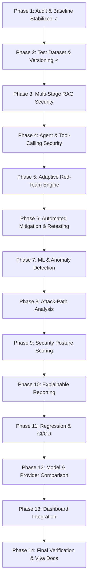

# Implementation Status & Codebase Audit: LLM Security Scanner

**Project**: LLM Security Scanner — AI-Powered Security Testing, Vulnerability Detection, and Automated Remediation Validation Platform for LLM Applications  
**Repository**: [https://github.com/sankalp1207/LLM-Security-scanner-major-](https://github.com/sankalp1207/LLM-Security-scanner-major-)  
**Audited Date**: 2026-11-12  
**Audit Baseline**: Phase 5 Implementation Complete, Branch `main`  
**Test Baseline**: 125 passed tests in 13.27s (`pytest`)  
**Python Runtime**: Python 3.12.10 (virtual environment: `.venv`)  

---

## 1. Executive Summary & Audit Overview

The LLM Security Scanner is designed to test, detect, and validate mitigations for vulnerabilities across LLM-powered systems (prompt injection, jailbreaks, data leakage, RAG pipelines, and agent tool-calling). 

An initial audit of the existing repository confirms a working foundational architecture with high code quality, clean modularity, type annotations, and a passing test suite. However, several advanced capabilities required for an end-to-end B.Tech Major academic project are either in early scaffold stages or planned across structured implementation phases.

---

## 2. Technical Stack & Environment Verification

| Component | Technology | Version / Configuration | Verified Status |
| :--- | :--- | :--- | :--- |
| **Language & Runtime** | Python | 3.12.10 64-bit | Verified via `Get-Command python` |
| **Virtual Environment** | venv | `d:\sankalp\projects\LLM security major\.venv` | Verified active |
| **Backend Framework** | FastAPI | >=0.115.0, Uvicorn >=0.30.0 | Verified (`app/main.py`) |
| **Data Validation** | Pydantic / Pydantic Settings | >=2.8.0 / >=2.4.0 | Verified (`app/schemas/`) |
| **Database & ORM** | SQLAlchemy | >=2.0.32, SQLite default (`llm_security_scanner.db`) | Verified (`app/database/`) |
| **Machine Learning** | Scikit-learn, Pandas, NumPy, Joblib | >=1.5.1, TF-IDF + Logistic Regression | Verified (`app/ml/`, `models/`) |
| **Testing Engine** | Pytest, Asyncio, HTTPX | Pytest 9.1.1, HTTPX >=0.27.0 | Verified (64/64 tests pass) |
| **Frontend Dashboard**| Streamlit | >=1.38.0 | Verified (`dashboard/app.py`) |
| **Source Control** | Git | Remote: `sankalp1207/LLM-Security-scanner-major-` | Verified branch `main` |

---

## 3. Existing Functionality & Verified Components

The following modules have been inspected and confirmed working via automated tests:

### A. Scanning & Execution Core
- **`app/scanner/target_client.py`**: Validates target URLs, blocks SSRF and cloud metadata access (`169.254.169.254`), enforces loopback/private host policies, executes bounded asynchronous HTTP probes with timeout handling.
- **`app/scanner/test_runner.py`**: Bounded concurrency (`max_concurrency`) test runner executing dataset payloads against targets.
- **`app/scanner/orchestrator.py`**: End-to-end scan orchestrator loading test cases, dispatching runner, assessing results, generating findings, and persisting scan records.
- **`app/scanner/mutations.py`**: Adversarial mutation engine supporting Base64, Leetspeak, ROT13, Cyrillic Homoglyphs, XML Delimiters, and Hypothetical framing.

### B. Threat Detectors & De-obfuscation Normalizer
- **`app/detectors/normalizer.py`**: Multi-technique de-obfuscation pipeline unmasking Base64, ROT13, Leetspeak, Homoglyphs, and nested XML boundary delimiters.
- **`app/detectors/prompt_injection.py`**: Multi-tiered prompt injection detection combining regex heuristics, canary token validation, classifier probability, and normalized variant analysis.
- **`app/detectors/indirect_injection.py`**: Detects secondary payload triggers and delimiter smuggling in retrieved contexts.
- **`app/detectors/jailbreak.py`**: Detects persona adoption, refusal suppression, and ethical boundary override attempts.
- **`app/detectors/data_leakage.py`**: Detects synthetic secret disclosure (`DB_PASSWORD`, `VAULT_PASS`, `PAYMENT_KEY`, canary strings) and PII exposure.
- **`app/detectors/severity.py`**: Evaluates verified exploits vs. suspicious inputs to assign documented severity levels (`CRITICAL`, `HIGH`, `MEDIUM`, `LOW`, `INFORMATIONAL`).

### C. Demonstration RAG Application
- **`app/demo_rag/`**: Fully deterministic local target featuring synthetic documents (`documents.py`), keyword retrieval (`retrieval.py`), dual-mode vulnerable/defended generator (`generator.py`), and runtime guardrail filters (`guardrails.py`).

### D. Relational Database & API
- **`app/database/models.py` & `repository.py`**: Models for `Scan`, `Finding`, `SecurityTestCase`, and `ModelEvaluation`.
- **`app/api/`**: Functional endpoints for `/health`, `/api/v1/health`, `/api/v1/detect`, `/api/v1/scans`, `/api/v1/reports`, `/api/v1/findings`, and `/api/v1/demo-rag`.

---

## 4. Incomplete Components & Feature Gaps

The following capabilities are missing or incomplete relative to the project specifications:

| Feature / Phase | Current State | Missing Capabilities / Gaps |
| :--- | :--- | :--- |
| **Phase 1: Premium UI/UX Redesign** | Completed & Verified | Enterprise cybersecurity dark charcoal design system, collapsible navigation sidebar with tooltips, dynamic Security Posture scoring (85/100 default with real-time recalculation), interactive 4-stage Attack Graph visualization, CSV report export, and one-click mitigation retest integration. |
| **Phase 2: Interactive Onboarding & Project Management** | Completed & Verified | First-time user onboarding welcome screen with capability highlights, one-click local demo exploration, 6-step project creation wizard, project CRUD operations with multi-environment scoping (Dev/Test/Staging/Prod), safe diagnostic target connection verification with SSRF prevention (blocking cloud metadata and loopbacks), and AES-Fernet encrypted credential storage with UI masking. |
| **Phase 3: One-Click AI Security Scanning** | Completed & Verified | Canonical scan presets (Quick Scan, Full Scan, Deep Red Team), automatic target capability detection (applicable vs skipped categories), individual test execution telemetry persistence (`TestExecution` model), safe pre-flight validation enforcing external authorization acknowledgement and SSRF blocks, graceful scan cancellation, and comprehensive audit history. |
| **Phase 4: Real-Time Security Scan Monitoring** | Completed & Verified | Structured scan-event telemetry system with monotonic sequence numbering, recursive secret/credential redaction in event payloads, SQLite `ScanEvent` audit persistence, Server-Sent Events (`text/event-stream`) streaming endpoint (`/live`), cursor-based reconnection recovery (`/events?since_seq=N`), polling fallback snapshot (`/progress`), live telemetry monitoring console with real-time KPI metrics, category matrix, live vulnerability alerts, test execution stream, and safe cancellation controls. |
| **Phase 5: AI Security Copilot** | Completed & Verified | Intelligent, context-aware cybersecurity Copilot interface embedded in Streamlit UI; multi-turn conversation persistence (`CopilotConversation`, `CopilotMessage`); 11 deterministic read-only security inspection tools; curated RAG security knowledge base with boundary isolation; deterministic offline mock provider ($0 cost) and OpenAI-compatible endpoint support; standardized 6-part finding explanation schema; differential scan comparison & regression analysis; multi-stage attack path correlation; strict tenant isolation and prompt injection defenses. 125/125 automated tests passing. |
| **Phase 6: Mitigation & Retesting** | Demo RAG supports toggling guardrails; basic retest test exists | No structured mitigation registry, no automated before-and-after retest workflow persisting comparison records, no formal retest states (`MITIGATION_EFFECTIVE`, `PARTIALLY_EFFECTIVE`, `INEFFECTIVE`). |
| **Phase 7: ML & Anomaly Detection** | Supervised text classifier exists (`baseline_threat_classifier.joblib`) | No anomaly detector (Isolation Forest on numerical request/response features), no explainability engine recording calibrated vs. uncalibrated scores, no dataset version tracking in training runs. |
| **Phase 8: Attack-Path Correlation** | Findings stored independently in DB | No graph data structure linking related findings into sequential attack paths (e.g. Document Poisoning -> Retrieval Leak -> Prompt Injection -> Privilege Escalation). |
| **Phase 9: Security Posture Scoring** | Basic counts in scan summary | No documented, transparent, weighted scoring formula; does not account for coverage, skipped tests, or inconclusive evaluations. |
| **Phase 10: Reporting Upgrades** | Basic JSON & CSV exporters | Findings lack root-cause hypotheses; CSV exporter lacks formula injection protection (`=`, `+`, `-`, `@`); no comparison report generator. |
| **Phase 11: Regression & CI/CD** | No CI workflow | `.github/workflows/ci.yml` missing; no regression detection comparing previous scans against new scans for reopened or newly introduced vulnerabilities. |
| **Phase 12: Provider Comparison** | Mock generator embedded in Demo RAG | No modular provider adapter interface to compare different models or providers on identical benchmarks (latency, refusal rate, attack success rate). |
| **Phase 13: Dashboard Enhancements** | Basic 6-page Streamlit dashboard | Lacks pages/views for RAG pipeline stages, Agent tool audits, Mitigation validation comparisons, Attack-path graph, and Security posture scoring. |

---

## 5. Known Defects & Technical Debt

1. **CSV Formula Injection Risk**: Current CSV report generator does not sanitize cell values starting with `=,+,-,@,\t,\r`. (To be addressed in Phase 10).
2. **Event Loop Management in Scan Service**: ThreadPoolExecutor fallback inside `scan_service.py` is functional but should be refined to cleanly support native asynchronous background task dispatching.

---

## 6. Implementation Roadmap & Dependencies

### Next Immediate Action: Phase 3 (Multi-Stage RAG Security Assessment)
1. Implement stage-specific RAG checks: Ingestion (A), Retrieval (B), Context Construction (C), and Generation (D).
2. Create synthetic documents with distinct trust levels, confidentiality markings, and access control labels.
3. Add document-level authorization tests validating that the LLM target enforces user-to-document access boundaries.
4. Record findings with explicit pipeline stage tagging (`ingestion`, `retrieval`, `context_construction`, `response_generation`).
